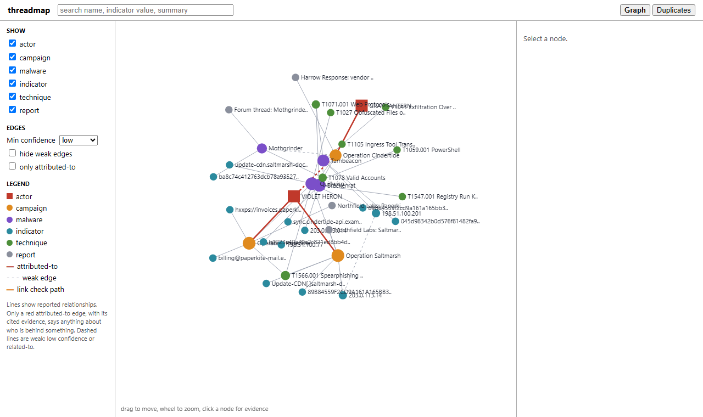

# threadmap

A small local tool for browsing how indicators, malware families, campaigns, ATT&CK techniques and reports relate, with actors treated as labels rather than facts. Every edge keeps its source, date, confidence and, where given, an alternative explanation.

The point is to avoid drawing a line between two indicators and letting the picture suggest they share an operator. A shared tool, shared hosting or a shared technique shows up as a connection, but only an `attributed-to` edge (which must carry evidence text) is treated as attribution. The link check in the detail panel says which case you are in, and warns when the only route between two nodes goes through weak edges (low confidence, or `related-to`).

## Usage

Needs Node 22.13 or newer (it uses `node:sqlite`). No dependencies.

    npm start            # http://127.0.0.1:8787, seeds data/sample.json into threadmap.db on first run
    npm test
    node src/cli.js my-dataset.json [db path]

Env: `PORT`, `THREADMAP_DB`.

In the UI: filter by node type, minimum confidence, weak edges; click a node for its edges with evidence; search by name or indicator value; pick "Use as link start" on one node, then "Check link" on another. The Duplicates tab lists indicators that normalise to the same value and lets you merge them.

## Data

A dataset is `{ "nodes": [...], "edges": [...] }`, see `data/sample.json`. Edges need `src`, `dst`, `rel` (`uses`, `indicates`, `reported-in`, `attributed-to`, `related-to`), `source`, `ts`, `confidence` (low/medium/high), and optionally `alt` and `evidence`. Import is all-or-nothing; invalid datasets are rejected with a list of problems.

The sample is synthetic: the actors, malware, campaigns, reports, domains and hashes are made up (domains use `.example`, IPs come from documentation ranges). The ATT&CK technique ids and names are real. It deliberately includes a low-confidence attribution, a related-to edge, and three duplicate indicator pairs.

## Limits
- Duplicate detection only compares normalised values of the same indicator. No fuzzy matching, no related-domain logic.
- "Weak" is a fixed rule (low confidence or `related-to`). There is no weighting beyond that, and a medium-confidence chain of many hops is not treated as weaker.
- The link check finds one shortest path, strong edges first. It does not enumerate alternatives.
- Attribution is only read from direct `attributed-to` edges on the two nodes; it does not propagate through campaigns or malware.
- The force layout is a plain O(n^2) loop; fine for hundreds of nodes, not for thousands.
- No STIX import, no auth, no editing in the UI beyond merging duplicates. The server binds to localhost only.
- The UI has only been looked at in Edge (headless), not in Firefox.
